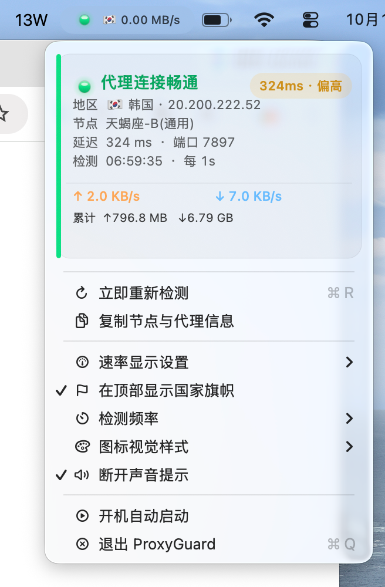

<div align="center">

# 🛡️ ProxyGuard for macOS

**An ultra-lightweight, aesthetically refined native macOS menu bar proxy monitor & real-time traffic meter.**

[](https://www.apple.com/macos/)
[](https://swift.org/)
[](LICENSE)
[]()

[English Document](README_EN.md) · [简体中文](README.md)

<br/>



</div>

---

### 💡 Why ProxyGuard?

When using proxy clients on macOS (such as Clash Verge, ClashX, Surge, Mihomo, or Sing-box):
1. **Silent Disconnections**: When a node times out or the client crashes, macOS system proxy remains enabled, silently severing the internet for all applications without notice.
2. **Lack of Live Status**: You cannot easily see if the proxy is healthy, what its latency is, or what country the exit node is in.
3. **No Isolated Proxy Speedometer**: macOS Activity Monitor only shows total physical network interface traffic, not the specific traffic flowing through the proxy.

**ProxyGuard** solves all of this: living cleanly in your menu bar with sub-second disconnection alerts, real-time proxy traffic measurement, and automatic exit country detection.

---

### ✨ Features

- 🟢 **Instant Disconnection Alert & Pulsing Heartbeat**:
  - Probes proxy health every second. Detects failures within 1.5 seconds and turns red immediately.
  - Triggers a pulsing breathing light animation and pushes a native macOS banner alert.
- ⚡️ **Real-time Proxy Traffic Meter**:
  - Displays actual proxy throughput in MB/s right beside the status dot (e.g. `🟢 🇺🇸 1.25 MB/s`).
  - Reads directly from the Mihomo/Clash core Unix Socket for 100% accurate proxy-only stats.
  - Apple native monospaced digit typography prevents jitter when numbers fluctuate.
- 🌍 **Automatic Country & Node Detection**:
  - Renders the node's country flag directly in the menu bar (`🇺🇸`, `🇯🇵`, `🇭🇰`, `🇸🇬`, etc.).
  - Dropdown card shows the exit country, full node name, and external IP.
- 🎨 **Apple HIG Native Aesthetic Craft**:
  - 4 customizable icon styles:
    - 🔮 **Neon Crystal LED** (Multi-stop gradient with curved glass specular highlight)
    - 💊 **Dynamic Capsule** (Modern rounded pill shape)
    - 🎯 **Precision Ring** (Dual concentric instrument ring)
    - 💎 **Minimal Gem Dot** (Clean 7pt titanium rim dot)
  - Floating glassmorphism dashboard card adapting dynamically to Dark & Light mode.
- 🍃 **Zero Dependencies & Extremely Lightweight**:
  - Pure native Swift & AppKit. Standalone binary is only ~120 KB.
  - Consumes only ~15 MB RAM and ~1% CPU.
- 📌 **Native ⌘ + Drag Reordering**:
  - Hold `Command (⌘)` and drag anywhere in your menu bar (e.g. right next to your battery wattage).
  - macOS permanently remembers your preferred position across reboots.

---

### 🚀 Quick Start

#### One-Line Installation (Recommended)

```bash
git clone https://github.com/YJYAMD/ProxyGuard.git
cd ProxyGuard
./scripts/install.sh
```

#### Manual Build

```bash
./scripts/build.sh
open build/ProxyGuard.app
```

---

### 📄 License

Released under the [MIT License](LICENSE).
